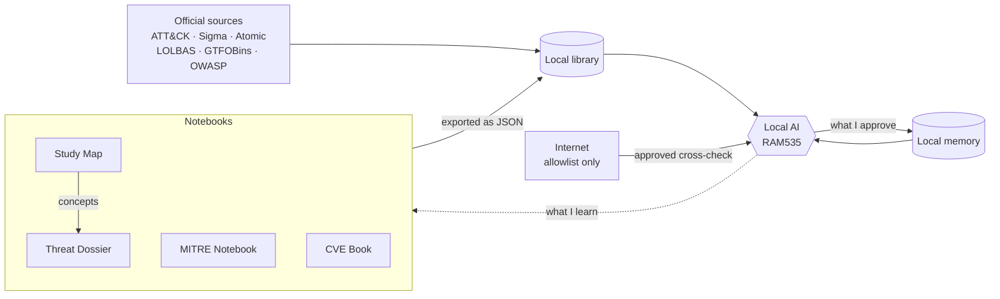

<h1 align="center">RAM535</h1>

<p align="center">
  A cybersecurity ecosystem made of a fully local AI assistant and four study notebooks that feed each other.
</p>

<p align="center">
  
  
  
  
</p>

<p align="center">
  <a href="README.md">Español</a> · <strong>English</strong>
</p>

<p align="center">
  <a href="https://ramiromp95.github.io/ram535/"><strong>Browse the notebooks online →</strong></a>
</p>

---

## What it is

RAM535 has two parts that work together.

- **The notebooks.** Four interactive pages, written in Spanish, where I collect what I study about threats, MITRE, vulnerabilities and hands-on SOC practice.
- **The AI.** A desktop application that turns a local language model (Gemma, served with Ollama) into a cybersecurity assistant. Its library is built from the notebooks and from official sources (MITRE ATT&CK, Sigma, Atomic Red Team, LOLBAS, GTFOBins, OWASP, CAPEC and CWE). It cross-checks against the internet and never goes online without permission.

I built it step by step to learn how to design a secure AI agent. Every security decision is documented and every issue found during audits has a numbered finding.

> Developed with the help of AI (Claude) as a tutor and reviewer. The design, the security decisions, the testing and the approval of every change are my own.

## How they feed each other



1. What I study goes into the notebooks. Concepts from the study map are also added to the dossier.
2. The notebooks are exported as JSON and imported into the AI library. Before importing, the program shows what has changed.
3. The AI answers from the library, links the pieces through a connection index computed by the program, and cross-checks with official online sources.
4. Whatever the AI finds and I approve is stored in its memory, and what I learn with it goes back into the notebooks.

## The notebooks

| Notebook | Content |
|---|---|
| [Threat Dossier](docs/dossier-de-amenazas/) | Living glossary of attacks, techniques, tools and concepts |
| [MITRE Notebook](docs/cuaderno-mitre/) | ATT&CK, D3FEND, CAR, ATLAS and AADAPT with search and cards |
| [CVE Book](docs/libro-de-cves/) | Vulnerabilities prioritised with CTEM logic, CVSS, EPSS and KEV |
| [Study Map](docs/mapa-de-estudio/) | Hands-on SOC and pentesting learning paths with notes and quizzes |

Each notebook is a single HTML page that works without a server, without sign-up and without tracking. Personal notes are stored only in the browser of whoever writes them.

## The AI

### What it does

| Mode | What it does |
|---|---|
| **Threat hunting** | Starts from a hypothesis based on an ATT&CK technique, suggests which logs to review and adapts Sigma rules |
| **Red team** | Organises authorised exercises by ATT&CK tactic and explains how the blue team would detect each technique |
| **Bug bounty** | Local program cards, scope checks computed by the program and CVSS 3.1 scored without AI |
| **Vulnerabilities** | Live CVE lookups in NVD, with EPSS and the CISA KEV catalogue |
| **Correlation** | Links technique, groups, software, detection and mitigation through an index computed by the program |

### Security by design

The guiding principle is to expose the computer as little as possible and to be able to verify it.

**Network**
- A single module (`red.py`) can reach the internet. It acts as a gatekeeper with an allowlist, HTTPS only and port 443 only
- DNS is checked and the connection is pinned to the IP to prevent DNS rebinding
- TLS 1.2 minimum with certificate verification, a 3-second pace and `robots.txt` compliance
- Every search is proposed by the AI and approved by the user. New allowlist entries require confirmation, and whole sites require double confirmation
- Every connection attempt is logged and shown in a side security panel

**Window**
- Content-Security-Policy with no network permissions and a SHA-256 hash of the script
- WebView2 engine behind a closed proxy on `127.0.0.1:9`, UI loaded without a server or open ports

**AI**
- Downloaded text is cleaned and always treated as data, never as instructions (prompt injection defence)
- A second fact layer removes techniques that are not in the official card and invented queries
- The AI cannot write to the allowlist or the source map
- In bug bounty mode nothing goes online if it mentions one of the user's programs

**Data**
- Local SQLite memory holding only what the user approves, parameterised queries, versioning and secure deletion

#### Audit findings

Example of how they are documented.

| ID | Finding | Resolution |
|---|---|---|
| H-01 | The WebView2 engine opened connections to an unneeded Microsoft service | Blocked at system level and verified with no further traffic |
| H-02 | An allowlist path without a trailing slash allowed paths that merely started the same way | Path matching fixed in the gatekeeper |
| H-03 | A web page could imitate the program's internal phrases | External text neutralised before it reaches the AI |

### Architecture

```
Window (index.html + ventana.js)
        │  allowed calls only
        ▼
main.py ── cerebro.py ── local Ollama (127.0.0.1)
        │       │
        │       ├── herramientas.py ── red.py ── internet (allowlist)
        │       ├── biblioteca.py   (SQLite FTS5, read-only for the AI)
        │       ├── memoria.py      (SQLite, approved data only)
        │       └── bugbounty.py    (scope and CVSS, no network)
        └── panel.py (security panel)
```

| File (in `app/`) | Purpose |
|---|---|
| `main.py` | Start-up, window and bridge between the UI and the program |
| `cerebro.py` | AI instructions, tool use and correlation |
| `herramientas.py` | Tools the AI can request (CVEs, news, reading sources, search) |
| `red.py` | The only way out to the internet |
| `limpiar.py` | Turns a web page into clean, neutralised text |
| `biblioteca.py` | Local library with search and a connection index |
| `memoria.py` | Local memory with versions and backups |
| `bugbounty.py` | Program cards, scope checks and a CVSS 3.1 calculator |
| `panel.py` | Data for the security panel |
| `lista_blanca.txt` | Allowed sites. Edited only by the user |
| `fuentes.txt` | Map of where to look for each kind of information |

The code and its comments are in Spanish.

### Tests

Each module ships with its own tests. Run them from the `app` folder with

```
python memoria.py
python bugbounty.py
python biblioteca.py
```

## Installation

Requirements. Windows 11, Python 3.13 and [Ollama](https://ollama.com) with a Gemma model downloaded.

```
python -m venv .venv
.venv\Scripts\activate
cd app
pip install -r requirements.txt
ollama pull gemma4:e4b
python main.py
```

The AI's library, memory and logs are not included in the repository. They are built on each machine, and every library source keeps its own licence.

## Repository layout

```
ram535/
├── app/    The AI. Desktop application code
└── docs/   The notebooks. Published as a website with GitHub Pages
```

## Responsible use

RAM535 is meant for learning and for working only on your own systems or with written authorisation. The AI's instructions prevent it from giving steps against out-of-scope assets, inventing findings or writing malware.

## Credits

MITRE ATT&CK®, CAPEC™ and CWE™ are trademarks of The MITRE Corporation. Sigma, Atomic Red Team, LOLBAS, GTFOBins and OWASP belong to their respective projects.
