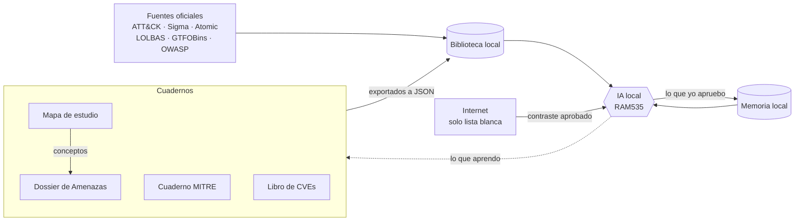

<h1 align="center">RAM535</h1>

<p align="center">
  Ecosistema de ciberseguridad formado por una IA que funciona entera en local y cuatro cuadernos de estudio que se alimentan entre sí.
</p>

<p align="center">
  
  
  
  
</p>

<p align="center">
  <strong>Español</strong> · <a href="README.en.md">English</a>
</p>

<p align="center">
  <a href="https://ramiromp95.github.io/ram535/"><strong>Ver los cuadernos en línea →</strong></a>
</p>

---

## Qué es

RAM535 tiene dos partes que trabajan juntas.

- **Los cuadernos.** Cuatro páginas interactivas en español donde reúno lo que estudio sobre amenazas, MITRE, vulnerabilidades y práctica de SOC.
- **La IA.** Una aplicación de escritorio que convierte un modelo de lenguaje local (Gemma, servido con Ollama) en un asistente de ciberseguridad. Su biblioteca se construye con los cuadernos y con fuentes oficiales (MITRE ATT&CK, Sigma, Atomic Red Team, LOLBAS, GTFOBins, OWASP, CAPEC y CWE), contrasta con internet y nunca sale a la red sin permiso.

Lo construí paso a paso para aprender cómo se diseña un agente de IA seguro. Cada decisión de seguridad quedó documentada y cada fallo encontrado en las auditorías tiene su hallazgo numerado.

> Desarrollado con ayuda de IA (Claude) como tutor y revisor. El diseño, las decisiones de seguridad, las pruebas y la aprobación de cada cambio son míos.

## Cómo se alimentan entre sí



1. Lo que estudio va a los cuadernos. Los conceptos del mapa de estudio también pasan al dossier.
2. Los cuadernos se exportan a JSON y se importan a la biblioteca de la IA. Antes de importar, el programa enseña qué ha cambiado.
3. La IA responde con la biblioteca, une las piezas con un índice de conexiones calculado por el programa y contrasta con fuentes oficiales de internet.
4. Lo que la IA encuentra y yo apruebo se guarda en su memoria, y lo que aprendo con ella vuelve a los cuadernos.

## Los cuadernos

| Cuaderno | Contenido |
|---|---|
| [Dossier de Amenazas](docs/dossier-de-amenazas/) | Glosario vivo de ataques, técnicas, herramientas y conceptos |
| [Cuaderno MITRE](docs/cuaderno-mitre/) | ATT&CK, D3FEND, CAR, ATLAS y AADAPT con buscador y fichas |
| [Libro de CVEs](docs/libro-de-cves/) | Vulnerabilidades priorizadas con lógica CTEM, CVSS, EPSS y KEV |
| [Mapa de estudio](docs/mapa-de-estudio/) | Rutas de aprendizaje práctico de SOC y pentesting con apuntes y test |

Cada cuaderno es una única página HTML que funciona sin servidor, sin registro y sin seguimiento. Las notas personales se guardan solo en el navegador de quien las escribe.

## La IA

### Para qué sirve

| Modo | Qué hace |
|---|---|
| **Threat hunting** | Parte de una hipótesis basada en una técnica ATT&CK, propone qué registros revisar y adapta reglas Sigma |
| **Red team** | Organiza ejercicios autorizados por tácticas ATT&CK y explica cómo detectaría cada técnica el equipo defensor |
| **Bug bounty** | Fichas de programa locales, comprobación del alcance calculada por el programa y CVSS 3.1 calculado sin IA |
| **Vulnerabilidades** | Consulta CVE en NVD al momento, con EPSS y el catálogo KEV de CISA |
| **Correlación** | Une técnica, grupos, software, detección y mitigación con un índice calculado por el programa |

### Seguridad por diseño

El principio de fondo es exponer el equipo lo mínimo posible y poder verificarlo.

**Red**
- Un único módulo (`red.py`) puede salir a internet. Funciona como portero con lista blanca, solo HTTPS y puerto 443
- DNS comprobado y conexión fijada a la IP para evitar el DNS rebinding
- TLS 1.2 como mínimo con certificado verificado, ritmo de 3 segundos y respeto a `robots.txt`
- Cada búsqueda la propone la IA y la aprueba el usuario. Las altas en la lista blanca piden confirmación, y el sitio entero doble confirmación
- Todo intento de conexión queda registrado y se muestra en un panel de seguridad lateral

**Ventana**
- Content-Security-Policy sin permisos de red y con huella SHA-256 del script
- Motor WebView2 con proxy cerrado en `127.0.0.1:9`, diseño cargado sin servidor ni puertos abiertos

**IA**
- El texto descargado se limpia y se trata siempre como datos, nunca como órdenes (defensa contra prompt injection)
- Segunda capa de hechos que elimina técnicas que no están en la ficha oficial y consultas inventadas
- La IA no puede escribir en la lista blanca ni en el mapa de fuentes
- En bug bounty nada sale a internet si menciona un programa del usuario

**Datos**
- Memoria local en SQLite solo con lo que el usuario aprueba, consultas con parámetros, versiones y borrado seguro

#### Hallazgos de auditoría

Ejemplo de cómo se documentan.

| ID | Hallazgo | Resolución |
|---|---|---|
| H-01 | El motor WebView2 abría conexiones a un servicio de Microsoft no necesario | Bloqueado a nivel de sistema y verificado sin tráfico posterior |
| H-02 | Una ruta de la lista blanca sin barra final permitía rutas que solo empezaban igual | Corregida la comparación de rutas en el portero |
| H-03 | Una web podía imitar frases internas del programa | Neutralización del texto externo antes de pasarlo a la IA |

### Arquitectura

```
Ventana (index.html + ventana.js)
        │  solo llamadas permitidas
        ▼
main.py ── cerebro.py ── Ollama local (127.0.0.1)
        │       │
        │       ├── herramientas.py ── red.py ── internet (lista blanca)
        │       ├── biblioteca.py   (SQLite FTS5, solo lectura para la IA)
        │       ├── memoria.py      (SQLite, solo lo aprobado)
        │       └── bugbounty.py    (alcance y CVSS, sin red)
        └── panel.py (panel de seguridad)
```

| Archivo (en `app/`) | Función |
|---|---|
| `main.py` | Arranque, ventana y puente entre la interfaz y el programa |
| `cerebro.py` | Instrucciones de la IA, uso de herramientas y correlación |
| `herramientas.py` | Herramientas que la IA puede pedir (CVE, noticias, lectura de fuentes, búsqueda) |
| `red.py` | Único punto de salida a internet |
| `limpiar.py` | Convierte una web en texto limpio y neutralizado |
| `biblioteca.py` | Biblioteca local con búsqueda e índice de conexiones |
| `memoria.py` | Memoria local con versiones y copias de seguridad |
| `bugbounty.py` | Fichas de programa, alcance y calculadora CVSS 3.1 |
| `panel.py` | Datos del panel de seguridad |
| `lista_blanca.txt` | Sitios permitidos. Solo lo edita el usuario |
| `fuentes.txt` | Mapa de dónde buscar cada tipo de información |

### Pruebas

Cada módulo trae sus propias pruebas. Se ejecutan desde la carpeta `app` con

```
python memoria.py
python bugbounty.py
python biblioteca.py
```

## Instalación

Requisitos. Windows 11, Python 3.13 y [Ollama](https://ollama.com) con un modelo Gemma descargado.

```
python -m venv .venv
.venv\Scripts\activate
cd app
pip install -r requirements.txt
ollama pull gemma4:e4b
python main.py
```

La biblioteca, la memoria y los registros de la IA no se incluyen en el repositorio. Se construyen en cada equipo, y cada fuente de la biblioteca mantiene su propia licencia.

## Estructura del repositorio

```
ram535/
├── app/    La IA. Código de la aplicación de escritorio
└── docs/   Los cuadernos. Se publican como web con GitHub Pages
```

## Uso responsable

RAM535 está pensado para aprender y para trabajar solo sobre sistemas propios o con autorización por escrito. Las instrucciones de la IA le impiden dar pasos sobre activos fuera de alcance, inventar hallazgos o escribir malware.

## Créditos

MITRE ATT&CK®, CAPEC™ y CWE™ son marcas de The MITRE Corporation. Sigma, Atomic Red Team, LOLBAS, GTFOBins y OWASP pertenecen a sus respectivos proyectos.
